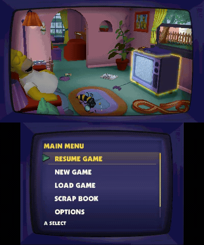

# The Simpsons: Hit & Run for Nintendo 3DS

A homebrew port for Nintendo 3DS and 2DS, including the original models. It also runs on New 3DS systems. You should own a copy of the original PC game.

## Features

- **Major graphical improvements:** enhanced lighting, character shading, car reflections and HUD artwork.
- **800×240 Quality Mode** on supported models.
- **Smoother performance:** 30 FPS target on original 3DS/2DS; 60 FPS target on New 3DS/New 2DS XL.
- **Refined stereoscopic 3D:** improved depth and steadier camera transitions.
- **World-loading fix:** preloaded exterior scenery across all seven levels prevents late map loading during fast driving. Initial loading may take longer.
- **More languages:** full Spanish 🇪🇸 and French 🇫🇷 text and dubbed voices, alongside English.
- **Bug fixes and polish:** mission restarts, level transitions, scrollable mission selection, intro videos and parked-car stability.

800×240 is wide output in 2D; stereo uses 400×240 per eye. Original 2DS remains at 400×240. Frame rates vary by scene; some distance culling and dynamic-object pop-in remain. See [graphics modes](docs/GRAPHICS_MODES.md).

## 🍩 browser builder

[Open the browser builder](https://alexmolina08.github.io/The-Simpsons-Hit-and-Run-O3DS/) to create an installable CIA from your PC copy:

1. Select your PC disc image or installed game folder.
2. If your copy includes several languages, choose the one you want.
3. Select **Build CIA**, then **Save CIA** when it finishes.

The builder detects English, French and Spanish copies. Your game files stay on your device. Allow at least **8 GB** of free space and keep the tab open while it works.

Developers can find setup instructions and validation details in [browser-builder/README.md](browser-builder/README.md).

## Screenshots

[Watch the menu tour](https://github.com/AlexMolina08/The-Simpsons-Hit-and-Run-O3DS/releases/download/v1.0.0/Simpsons-Hit-and-Run-3DS-v1.0.0-menu-tour.mp4) or [view screenshots](images/screenshots/). The footage was captured in Azahar.

## Install or update

You need a console with custom firmware, FBI and your console's DSP firmware at `sd:/3ds/dspfirm.cdc`.

1. Copy your CIA to `sd:/cias/`. Keep at least **4 GB free** before copying it.
2. On the console, open **FBI → SD → cias**, select the CIA and choose **Install CIA**.
3. Once installation finishes, launch the game from the HOME Menu.

To update, first back up `sd:/3ds/simpsons/`, then install the new CIA over the existing title. Do not uninstall the game or delete that folder: it contains your saves and settings.

See the [installation and update guide](docs/INSTALL.md) for detailed instructions and source builds.

## Controls

| Input | Action |
| --- | --- |
| Circle Pad / D-pad | Move, steer or navigate menus |
| A | Jump, accelerate or confirm |
| B | Run, brake, reverse or go back |
| X | Interact or enter/exit a vehicle |
| Y / R | Attack or handbrake |
| L + Circle Pad | Move the camera |
| New 3DS C-stick | Move the camera |
| L + R | Horn |
| Select / L + Select | Reset vehicle / change camera |
| Start | Pause or continue |

The Old 3DS Circle Pad Pro attachment is not supported. Use L + Circle Pad for the camera.

The touch screen shows the map, counters, mission objective and context-sensitive actions. Options include stereoscopic 3D on compatible consoles and a choice of graphics modes. See [graphics modes](docs/GRAPHICS_MODES.md) for details.

Performance varies by scene; demanding areas can run below 30 FPS on original hardware.

## Development

See [CONTRIBUTING.md](CONTRIBUTING.md) for builds, tests and bug reports. Retail game data, DSP firmware and completed installers are not included in the source tree.

## Credits

The original game was developed by Radical Entertainment. This port builds on [x2apic's New 3DS port](https://github.com/x2apic/The-Simpsons-Hit-and-Run-N3DS) and [ZenoArrows' Switch and PS Vita port](https://github.com/ZenoArrows/The-Simpsons-Hit-and-Run). This version is maintained by [AlexMolina08](https://github.com/AlexMolina08). Movie playback follows [REGTA-3DSPort-Complete](https://github.com/Epic0522/REGTA-3DSPort-Complete). Built with devkitPro, libctru and Citro3D.
