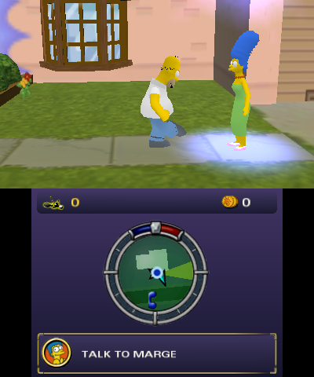
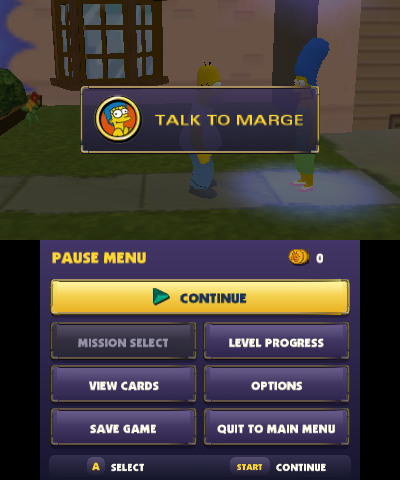
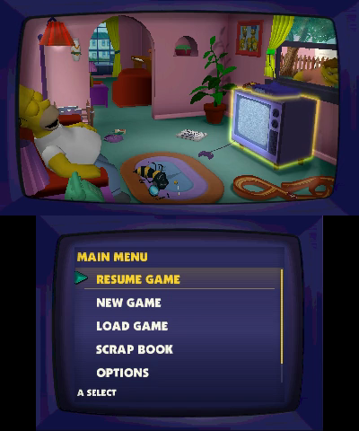
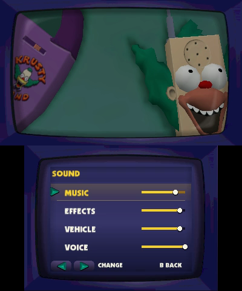
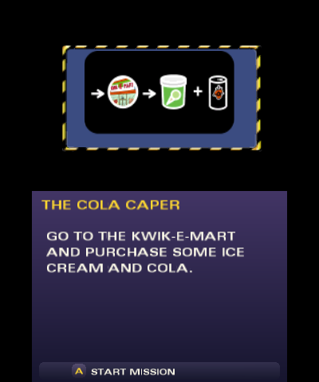
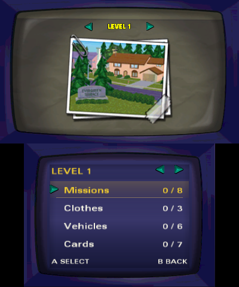

# The Simpsons: Hit & Run for Nintendo 3DS

Version **1.0**. A homebrew port for original Nintendo 3DS and 2DS. The same build also runs on
New 3DS and New 2DS XL, enabling their faster CPU and L2 cache automatically.
You need your own retail PC copy of the game to build from source.
Game data and DSP firmware are not distributed in this source repository.

[Install](#install) · [Build from your PC copy](#build-a-cia) · [Controls](#interface-and-controls) · [Release notes](https://github.com/AlexMolina08/The-Simpsons-Hit-and-Run-O3DS/releases/tag/v1.0.0)

## Screenshots and menu tour

Original artwork and fonts, a touch-screen HUD, television menus and native button navigation.

<a href="https://github.com/AlexMolina08/The-Simpsons-Hit-and-Run-O3DS/releases/download/v1.0.0/Simpsons-Hit-and-Run-3DS-v1.0.0-menu-tour.mp4"></a>

[Watch or download the 25-second menu tour](https://github.com/AlexMolina08/The-Simpsons-Hit-and-Run-O3DS/releases/download/v1.0.0/Simpsons-Hit-and-Run-3DS-v1.0.0-menu-tour.mp4).
Silent footage captured in Azahar at native resolution, with cuts between sections.

<details>
<summary>View gameplay and menu screenshots</summary>

Captures use the native 400×240 top screen and 320×240 touch screen. Click an image for full size.
These are emulator captures, not measurements of console performance.

<table>
<tr><th>Gameplay HUD</th><th>Pause menu</th></tr>
<tr>
<td></td>
<td></td>
</tr>
<tr><th>Main menu</th><th>Sound</th></tr>
<tr>
<td></td>
<td></td>
</tr>
<tr><th>Mission briefing</th><th>Scrapbook</th></tr>
<tr>
<td></td>
<td></td>
</tr>
</table>

</details>

## Install

The [complete 1.0 CIA](https://github.com/AlexMolina08/The-Simpsons-Hit-and-Run-O3DS/releases/download/v1.0.0/Simpsons-Hit-and-Run-3DS-v1.0.0.cia) includes game data and all 17 cinematics.
It is **1.92 GB**. A console with custom firmware and FBI is required.

### Install from SD — recommended

1. Download the CIA on your computer, or build it from your PC copy below.
2. Copy it to `sd:/cias/`. Keep at least **4 GB free before copying**, for the CIA and installed game.
3. In **FBI → SD → cias**, select the CIA and choose **Install CIA**.
4. Launch the game from the HOME Menu. After installation, you can remove the CIA file from `cias/`.

Sound needs your console's DSP firmware at `sd:/3ds/dspfirm.cdc`, dumped with DSP1.
Saves and settings live in `sd:/3ds/simpsons/`; keep that folder when updating.

### Install with a QR code

Open **FBI → Remote Install → Scan QR Code** and scan the image below from another screen.
The code points directly to the same complete 1.0 CIA.

<a href="images/cia-install-qr.png"></a>

[Open the QR at full size](images/cia-install-qr.png). Keep its white border visible; if it does not scan, open the full-size image and adjust your screen brightness or camera distance.

If FBI reads the code but the download or installation fails, use the SD method above.
The complete game is a large download over console Wi-Fi. For a bug report, include your FBI version, exact error code and the percentage reached.

See the [1.0 release notes](https://github.com/AlexMolina08/The-Simpsons-Hit-and-Run-O3DS/releases/tag/v1.0.0) for package details.

### Updating an existing installation

Back up `sd:/3ds/simpsons/` first. Install the new CIA with FBI over the existing
installation; replacing the file on SD alone does not update the installed game.
The title ID and save format are unchanged, so your progress and settings remain.
The old map-placement setting is ignored because the map now always uses the
lower screen. Keep your DSP firmware.

For a fresh start, back up and rename `sd:/3ds/simpsons/` before launching the new
version. The game creates a new folder; your backup retains the old saves.
Uninstalling the existing title is not required.

## Build a CIA

macOS and Linux need Git, Bash, CMake 3.28+, Ninja, GNU Make, host C and C++ compilers,
Python 3.11+, Pillow and FFmpeg. Install devkitPro's `3ds-dev` package group using its
[setup guide](https://devkitpro.org/wiki/Getting_Started).
Windows users use WSL 2 with Ubuntu 24.04. Install its Linux devkitPro toolchain,
then follow the [Windows setup steps](docs/OLD3DS.md#windows-wsl-2).

On macOS, install the Xcode command-line tools and host dependencies:

```sh
xcode-select --install
brew install cmake ninja python ffmpeg
```

After installing devkitPro, clone the source and build:

```sh
git clone https://github.com/AlexMolina08/The-Simpsons-Hit-and-Run-O3DS.git
cd The-Simpsons-Hit-and-Run-O3DS
python3 -m venv .venv
source .venv/bin/activate
python3 -m pip install Pillow
python3 tools/3ds/make_cia.py "/path/to/PC game"
```

Point at the PC folder containing `art/`, `scripts/`, `sound/`, `movies/` and the
`.rcf` archives. The command prepares retail data, converts and fully validates all 17 movies,
rebuilds the accepted native texture bundle, builds the original-model executable
and packages **`out/releases/v1.0.0/Simpsons-Hit-and-Run-3DS-v1.0.0.cia`**.
Its checksum, movie validation report and asset manifest appear alongside it.
The first build downloads source dependencies and can take several minutes. Later builds reuse them.

On macOS, **Build CIA.command** runs the same local build and asks for the PC
folder. It does not upload, tag or publish anything.
macOS (Apple Silicon and Intel), Linux x86-64 and WSL can prepare makerom and bannertool automatically. Other architectures must install them or
pass `--makerom /path/to/makerom --bannertool /path/to/bannertool`.

Use `--clean` for a fresh dependency and game compilation. It moves previous
compilation outputs and generated texture cache to the system Trash after checking prerequisites. Retail
files, saves, screenshots and existing release packages are preserved.
See the [build guide](docs/OLD3DS.md) for Linux prerequisites, Homebrew Launcher
builds, controls and publishing a separate release.

## Interface and controls

Gameplay uses the native 400×240 top screen. The touch screen carries the original
radar, coin and wasp counters, current objective and a contextual interaction control.
Menus use original game artwork and fonts, with touch, D-pad and Circle Pad navigation.
Tap a menu item to select it; drag away before releasing to cancel. Slider labels
focus a row; their tracks adjust the value. The map always uses the lower screen.

| Input | Action |
| --- | --- |
| Circle Pad / D-pad | Move, steer or navigate menus |
| A | Jump / accelerate / confirm |
| B | Run / brake and reverse / back |
| X | Interact / enter or exit vehicle |
| Y | Attack / handbrake |
| Hold L + Circle Pad | Move camera |
| R | Handbrake |
| L + R | Horn |
| Select | Reset vehicle |
| L + Select | Cycle camera |
| Start | Pause / continue |

Port attribution appears above the original game credits under
**Main Menu → Options → View Credits**.

Reopening the lid while the game is running plays a short greeting from Homer,
Bart, Lisa, Marge or Apu. Ten complete retail lines play in a shuffled order,
with no consecutive repeats. Greetings follow the **Voice** volume setting;
setting Voice to zero silences them. Returning from HOME alone does not trigger one.

Performance varies by scene; demanding areas can run below 30 FPS. Emulator results do not establish performance on an original console.

## Development

`cmake/old3ds-release.cmake` defines the normal-play build profile. It preserves the accepted v104 rendering options and
original-model memory limits, with benchmark automation and profiling disabled. The `v1.0.0` and `old3ds-ui-baseline` tags mark this
baseline. Build and package checks do not replace installed-console testing.

See [CONTRIBUTING.md](CONTRIBUTING.md) for regression checks and bug reports.

AI helped expand the regression tests with hundreds of generated cases and edge conditions.
See [the testing notes](docs/AI_TESTING.md) for a concrete example and how to run it.

## Credits

The original game was developed by Radical Entertainment.
This port builds on [x2apic's New 3DS port](https://github.com/x2apic/The-Simpsons-Hit-and-Run-N3DS)
and [ZenoArrows' Switch and PS Vita port](https://github.com/ZenoArrows/The-Simpsons-Hit-and-Run).
Old 3DS work is maintained by [AlexMolina08](https://github.com/AlexMolina08).
Movie playback follows [REGTA-3DSPort-Complete](https://github.com/Epic0522/REGTA-3DSPort-Complete) by Epic0522.
Built with devkitPro, libctru and Citro3D.
