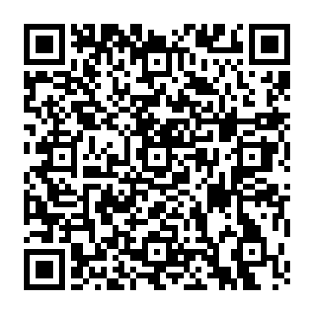

# The Simpsons: Hit & Run for Nintendo 3DS

**You must own a legal copy of The Simpsons: Hit & Run to use this port.**

A homebrew port for Nintendo 3DS, optimized for the original Nintendo 3DS and 2DS.
The same CIA also supports New 3DS and New 2DS XL, enabling their faster CPU and
L2 cache automatically while retaining the original-model memory budget.
Based on x2apic's New 3DS port, with original-model rendering, memory, controls
and software movie playback work.
Building from source requires your own legal copy of the PC game. Game assets and DSP
firmware are not included in this source repository.


## Install the CIA

The complete CIA test build is available under
[Releases](https://github.com/AlexMolina08/The-Simpsons-Hit-and-Run-O3DS/releases).
Install it with FBI on a console configured to run homebrew CIAs. No separate
game-data copy is needed.
Saves and settings use `sd:/3ds/simpsons/`. Audio requires your console's DSP
firmware at `sd:/3ds/dspfirm.cdc`, dumped with DSP1.

This is a test release. Check its release notes for the current validation status
and known limits. Performance varies by scene; demanding areas do not maintain
30 FPS.

## Original 3DS and 2DS

See the [complete source build guide and controls](docs/OLD3DS.md).
The guide covers toolchain installation, PC game data, movie conversion and
building an executable for the original hardware.

The original models use a single 400×240 gameplay view. The lower screen shows a
TV menu with touch selection, a frame-synced gameplay map, and the original newspaper loading art.
Performance varies by scene; demanding areas do not maintain 30 FPS.

```sh
python3 -m venv .venv
. .venv/bin/activate
python3 -m pip install imageio-ffmpeg
python3 tools/3ds/setup_sd.py "/path/to/PC game" --old3ds
bash tools/3ds/build_old3ds.sh
cp out/old3ds/SimpsonsNTSC.3dsx sdcard/3ds/simpsons/
```

Install the prerequisites in the build guide before running these commands.
Keep `--old3ds`: it selects the software movie format required by original models.
These commands produce a Homebrew Launcher build. The guide also explains
[complete CIA packaging](docs/OLD3DS.md#build-a-complete-cia).

Copy `sdcard/3ds` to the SD card root. Launch through the Homebrew Launcher.
Sound requires your console's DSP firmware at `sd:/3ds/dspfirm.cdc`, dumped with DSP1.

## New 3DS and New 2DS XL

Install devkitPro with `3ds-dev`, `3ds-sdl` and `3ds-libpng`, plus Python and
`imageio-ffmpeg`. On Windows:

```bat
build.bat "C:\Program Files (x86)\Vivendi Universal Games\The Simpsons Hit & Run"
```

This builds the game and prepares its data under `sdcard/`.
To prepare data without building:

```sh
python3 tools/3ds/setup_sd.py "/path/to/PC game"
```

## Make a new CIA release

On macOS, double-click **Release CIA.command** and choose the suggested version.
Commit your source changes on `main` first. The launcher builds the game, packages
the complete CIA, creates a version tag and uploads a test release to GitHub.
It verifies uploaded checksums before publishing and never replaces an existing
public version.

Use the [release guide](docs/OLD3DS.md#local-release-launcher) for prerequisites,
local-only builds and resuming an interrupted upload.

## Development

See [CONTRIBUTING.md](CONTRIBUTING.md) for host checks, patch guidelines and
hardware test reports. The [build guide](docs/OLD3DS.md) covers the toolchain,
controls and packaging. Report reproducible problems through
[Issues](https://github.com/AlexMolina08/The-Simpsons-Hit-and-Run-O3DS/issues).

## Credits

Based on [x2apic's New 3DS port](https://github.com/x2apic/The-Simpsons-Hit-and-Run-N3DS)
and [ZenoArrows' Switch and PS Vita port](https://github.com/ZenoArrows/The-Simpsons-Hit-and-Run).
Movie playback follows [REGTA-3DSPort-Complete](https://github.com/Epic0522/REGTA-3DSPort-Complete) by Epic0522.
Built with devkitPro, libctru and Citro3D.

## Install with a QR code

Open **FBI → Remote Install → Scan QR Code** on your Nintendo 3DS.
This QR code links directly to the v0.1.1-rc.1 CIA preview for testing.
This is a test build, not a stable release. We recommend obtaining a legal copy
of the original game before testing this port.



[Download the CIA](https://github.com/AlexMolina08/The-Simpsons-Hit-and-Run-O3DS/releases/download/v0.1.1-rc.1/Simpsons-Hit-and-Run-3DS-v0.1.1-rc.1.cia)

The download is approximately 1.90 GB. See the
[release notes](https://github.com/AlexMolina08/The-Simpsons-Hit-and-Run-O3DS/releases/tag/v0.1.1-rc.1)
for requirements and the current test-build status.
